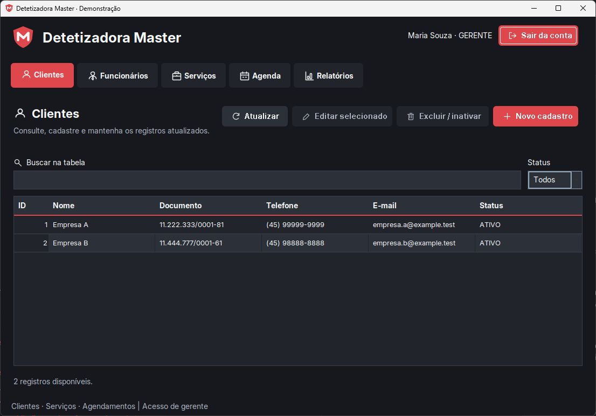
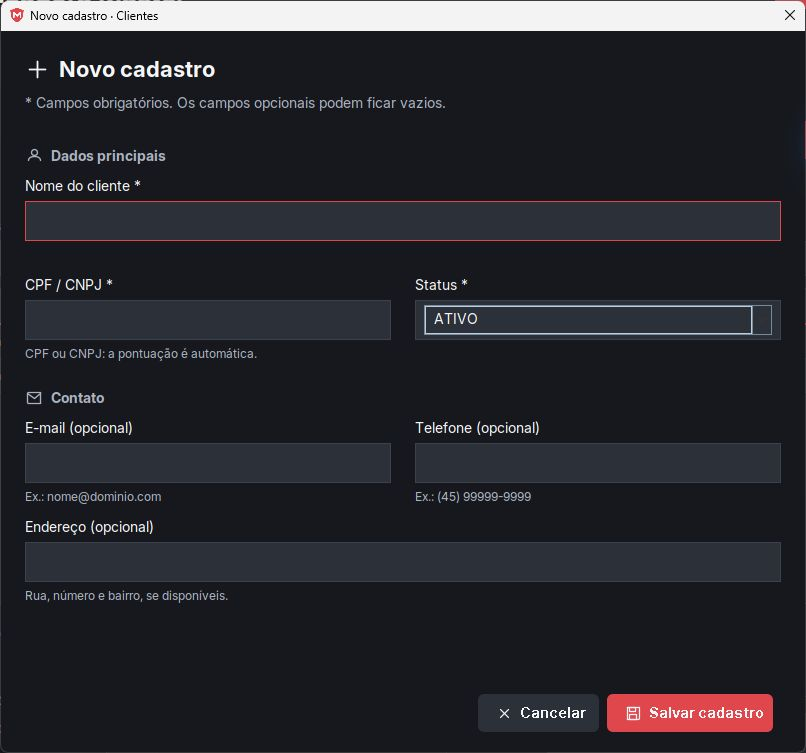
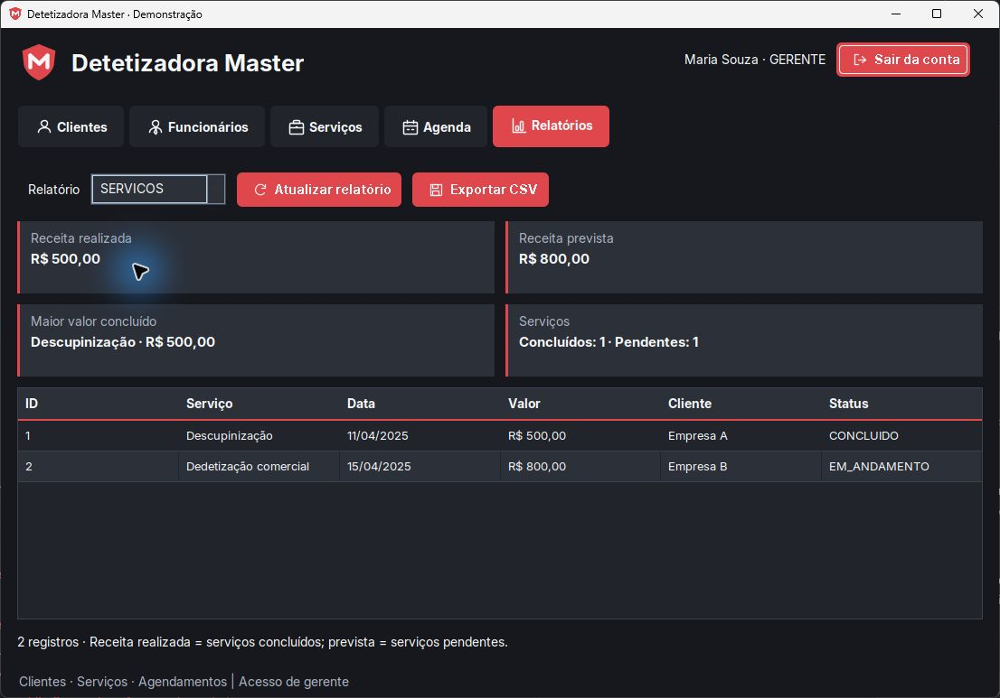

<div align="center">
  
  <h1>Detetizadora Master</h1>
  <p>Gestão de clientes, serviços e agendamentos em uma aplicação desktop Java.</p>
  <p><strong>Java 21 · Swing · PostgreSQL · JPA/Hibernate · Flyway · JUnit 5</strong></p>
</div>



## Sobre o projeto

Sistema acadêmico desenvolvido para organizar a operação de uma empresa de controle de pragas: clientes, funcionários, serviços e agenda de atendimentos. A proposta é centralizar informações que antes eram tratadas informalmente pelo WhatsApp.

Desenvolvido no curso de Análise e Desenvolvimento de Sistemas da UniAmérica Descomplica, em Foz do Iguaçu — PR.

## Funcionalidades

| Área | Recursos |
| --- | --- |
| Clientes | Cadastro, edição, pesquisa, filtro por status e validação de CPF/CNPJ, incluindo dígitos verificadores. |
| Funcionários | Cadastro, cargos, salário, senha e inativação. Acesso exclusivo de gerente. |
| Serviços | Vínculo com cliente, descrição, data, valor e acompanhamento por status. |
| Agenda | Serviço, responsável, data, horário, observações e filtros por período/status. |
| Relatórios | Resumos de clientes, funcionários, serviços e agenda, com exportação CSV. |
| Acesso | Autenticação com BCrypt, permissões por cargo e encerramento de sessão. |

CPF/CNPJ e telefone recebem pontuação automática, inclusive ao colar valores, e são armazenados somente com dígitos. E-mail, telefone e endereço são opcionais quando disponíveis no cadastro, com validação quando preenchidos. Os erros aparecem junto ao campo correspondente.

A interface usa tema escuro com destaque vermelho, fonte Inter, ícones vetoriais, navegação por abas e formulários separados das tabelas. Consultas e gravações rodam em segundo plano com `SwingWorker`.

### Cadastros organizados



### Relatórios e exportação



Receita realizada considera serviços concluídos; receita prevista considera serviços agendados ou em andamento. O maior valor concluído representa o valor do serviço, sem cálculo de lucro. O relatório da agenda mostra atendimentos pendentes entre hoje e os próximos três meses. O CSV usa separador `;`, UTF-8 com BOM e proteção contra interpretação de textos como fórmulas.

As imagens usam somente dados demonstrativos, em um banco separado.

## Permissões e regras

| Operação | Funcionário | Gerente |
| --- | :---: | :---: |
| Consultar e cadastrar/editar clientes e serviços ativos | Sim | Sim |
| Criar e editar agendamentos | Sim | Sim |
| Excluir/inativar registros e cancelar agendamentos | Não | Sim |
| Gerenciar funcionários e salários | Não | Sim |
| Consultar relatórios e exportar CSV | Não | Sim |

Agendamentos pendentes devem estar no futuro, usar serviço pendente e responsável ativo. O sistema impede dois atendimentos pendentes do mesmo responsável na mesma data e horário; essa regra não calcula duração nem sobreposição entre intervalos.

Serviços e agendamentos concluídos têm proteção contra exclusão/cancelamento. Vínculos podem impedir a exclusão de clientes ou serviços; nesses casos, use a inativação. O gerente não pode inativar a própria conta nem retirar o próprio cargo de gerente. Funcionários com atendimentos pendentes precisam ter sua agenda resolvida antes da inativação.

## Como executar

### Pré-requisitos

- JDK 21 ou superior.
- Maven 3.9 ou superior.
- PostgreSQL instalado e em execução.

A integração foi validada com PostgreSQL 18. O Flyway 10.10.0 emite um aviso por ter suporte oficialmente testado até PostgreSQL 16; o aviso não impediu os testes nesta configuração.

### 1. Obter o projeto

```bash
git clone https://github.com/TheRolann/ProjetoDetetizadoraMaster-TerceiroPeriodo.git
cd ProjetoDetetizadoraMaster-TerceiroPeriodo/Mensal1
```

### 2. Criar o banco

No PostgreSQL, com um usuário que tenha permissão para criar bancos:

```sql
CREATE DATABASE detetizadora_master;
```

O usuário da aplicação precisa poder criar e alterar as tabelas nesse banco. O Flyway executa as migrações na inicialização e inclui dados demonstrativos.

### 3. Configurar a conexão

| Variável | Valor padrão |
| --- | --- |
| `DB_URL` | `jdbc:postgresql://localhost:5432/detetizadora_master` |
| `DB_USER` | `postgres` |
| `DB_PASSWORD` | Obrigatória; sem valor padrão. |

**PowerShell:**

```powershell
$env:DB_URL = "jdbc:postgresql://localhost:5432/detetizadora_master"
$env:DB_USER = "postgres"
$env:DB_PASSWORD = "sua_senha_do_postgres"
```

**Linux/macOS:**

```bash
export DB_URL="jdbc:postgresql://localhost:5432/detetizadora_master"
export DB_USER="postgres"
export DB_PASSWORD="sua_senha_do_postgres"
```

O `persistence.xml` contém os metadados JPA, sem credenciais. Flyway e Hibernate usam as mesmas variáveis. Na IDE, configure-as na execução do `Main`; se alterar as variáveis do Windows com a IDE aberta, reinicie a IDE para receber os novos valores.

### 4. Compilar e abrir

Na pasta `Mensal1`, use o mesmo terminal em que definiu as variáveis:

```bash
mvn clean package
java -jar target/Mensal1-1.0-SNAPSHOT.jar
```

O JAR inclui as dependências Java. O PostgreSQL precisa continuar disponível durante o uso. Pela IDE, execute `br.edu.uniamerica.projetomensal.Main`.

### Acessos demonstrativos

Em um banco recém-criado, as migrações disponibilizam:

| Perfil | Usuário | Senha |
| --- | --- | --- |
| Gerente | Maria Souza | 1234 |
| Funcionário | João Silva | 1234 |

Entre como **Maria Souza** para acessar funcionários e relatórios. Essas credenciais são de demonstração; substitua as senhas antes de usar dados reais. Novos usuários são cadastrados pelo gerente na aba **Funcionários**. Na edição, deixar a senha vazia mantém a senha atual.

## Arquitetura

```text
Interface Swing → Controller → Service → Repository → PostgreSQL
                                  ↓
                         Validações e transações
```

| Pacote | Responsabilidade |
| --- | --- |
| `view` / `view.panels` | Telas, tema, máscaras, mensagens e tarefas assíncronas. |
| `controller` | Recebe as ações das telas e encaminha para os serviços. |
| `service` | Regras de negócio, autorização e transações. |
| `repository` | Consultas e persistência com JPA. |
| `model` / `model.enums` | Entidades e estados de clientes, funcionários, serviços e agenda. |
| `config` | Conexão, migrações e sessão do usuário. |
| `utils` | Validações, erros de negócio, rollback e exportação CSV. |

Cada tarefa da interface recebe um `EntityManager` próprio, fechado ao terminar. As migrações mantêm o esquema, vínculos e histórico dos serviços no banco.

```text
Mensal1/
├── pom.xml
├── src/main/java/br/edu/uniamerica/projetomensal/
│   ├── Main.java
│   ├── config/ · controller/ · model/ · repository/
│   └── service/ · utils/ · view/
├── src/main/resources/
│   ├── db/migration/        # Migrações V1 a V9
│   ├── fonts/               # Fontes da interface
│   └── META-INF/persistence.xml
├── src/test/java/           # Testes unitários e de integração
└── deprecated/             # Versões antigas, fora da compilação
docs/images/                # Logo e capturas do README
```

## Testes

Na pasta `Mensal1`:

```bash
mvn test
```

Sem banco, são executados **24 testes unitários**; os **19 testes de integração** ficam desativados por padrão. A última validação completa executou **43 testes**, sem falhas, erros ou testes ignorados.

Para a integração, crie um banco local separado chamado `master_test`, sem dados reais. Os testes executam migrações e alteram registros nesse banco.

```powershell
$env:DB_URL = "jdbc:postgresql://127.0.0.1:5432/master_test"
$env:DB_USER = "usuario_do_banco_de_testes"
$env:DB_PASSWORD = "senha_do_banco_de_testes"
$env:MASTER_INTEGRATION = "1"
mvn test
Remove-Item Env:MASTER_INTEGRATION
```

Antes de abrir a aplicação normal, restaure `DB_URL`, `DB_USER` e `DB_PASSWORD` para a conexão desejada. A cobertura inclui documentos, contatos opcionais, máscaras, CSV, persistência, permissões, conflitos de agenda e relatórios.

## Problemas comuns

| Situação | Como resolver |
| --- | --- |
| `Defina DB_PASSWORD` | Configure a variável na execução da IDE ou no terminal que abrirá o JAR. Reinicie a IDE após alterar variáveis do Windows. |
| Conexão recusada | Verifique se o PostgreSQL está ativo e confira host/porta de `DB_URL`. |
| Banco inexistente | Crie o banco indicado em `DB_URL` antes de iniciar. |
| Falha de autenticação do PostgreSQL | Confira `DB_USER` e `DB_PASSWORD`; a senha do banco é diferente da senha do login da aplicação. |
| Aba Funcionários/Relatórios ausente | Entre com um gerente, como Maria Souza no banco demonstrativo. |
| Documento ou horário recusado | Confira a mensagem do campo; documentos repetidos e horários já ocupados são bloqueados. |
| Divergência de checksum do Flyway | V3 a V6 foram corrigidas durante a evolução do projeto. Em bancos antigos, analise o histórico e faça backup antes de qualquer ajuste. A aplicação não executa `repair()` automaticamente. |

## Equipe

| Integrantes |
| --- |
| Luan Augusto de Castro Rolan |
| Adriano Ramos dos Santos Junior |
| Victor Hugo de Almeida Marques |
| Victor Luís da Luz |

**Mentor:** Riad Younes — Engenheiro de Software FrontEnd

**Orientador:** Victor Matheus de Souza Muller
